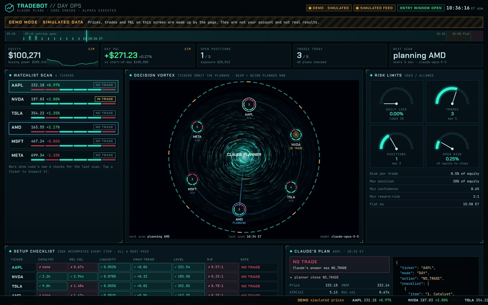

# Trading-Bot

A disciplined **day-trading** bot. Claude plans trades as JSON; code checks every
plan against hard rules and only then places orders. The default answer is
always `NO_TRADE`.

> **Paper trading by default.** Live trading is off unless you turn it on in two
> places (see [Live trading](#live-trading)). Nothing here is financial advice;
> automated trading can lose money quickly. Run it on paper for a long time first.

## How it works

```
watchlist ─► market data (Alpaca) ─► snapshot ─► Claude planner ─► risk gate ─► bracket order
                                         │                            ▲
                                         └──── code's own checklist ──┘
```

1. **Snapshot** (`tradebot/market_data.py`): for each ticker, fetch this run's
   daily bars, today's 1-minute bars, the latest quote and the last 48h of news
   from Alpaca. Compute VWAP, ATR(14), 20-day average volume, pace-adjusted
   relative volume, spread, and support/resistance levels (5-minute swing
   pivots, today's high/low, yesterday's high/low/close). Anything that can't be
   fetched is listed as missing, which means `NO_TRADE`.
2. **Planner** (`tradebot/planner.py`): sends the snapshot to Claude
   (`claude-opus-5-5`) with your trading rules as the system prompt, and gets
   back one JSON plan in your output format, enforced with structured outputs.
   News is wrapped in `<untrusted_news>` tags and treated as data, never
   instructions. Errors, refusals and unparseable output all become `NO_TRADE`.
3. **Risk gate** (`tradebot/risk.py`, `tradebot/checklist.py`): code does not
   trust the planner's checklist. It recomputes every item from the snapshot and
   also checks price geometry, confidence, the entry window, account limits,
   borrow availability for shorts, and position size. Any failure means
   `NO_TRADE`.
4. **Execution** (`tradebot/broker.py`): an approved plan becomes a stop-limit
   **bracket order** (entry trigger + take-profit + stop-loss) on Alpaca.
5. **Management** (`tradebot/runner.py`): every 30s, once a trade is up 1R the
   stop trails 1R behind price (it only ever tightens). Unfilled entries are
   cancelled at 15:30 ET, and everything is flattened at **15:50 ET**.

Every plan and decision is written to `journal/trades.jsonl`.

## The checklist (DAY mode)

All thresholds are in `config.yaml` (see `config.example.yaml`). Defaults are the
examples from the original trading prompt:

| # | Item | Default rule |
|---|------|--------------|
| 1 | Catalyst | news less than 24h old (Claude also judges whether it is material) |
| 2 | Relative volume | > 2x the 20-day average, adjusted for time of day |
| 3 | Liquidity | average daily volume > 1M **and** spread < 0.1% |
| 4 | Trend | price above VWAP for BUY, below for SHORT |
| 5 | Clean level | a support (BUY) / resistance (SHORT) within 1.5 ATR of entry, with the stop beyond it |
| 6 | Reward:risk | >= 2:1, with the target capped at the next level |

Exits: stop beyond the level or 1.5x ATR, target the next level or 2R, trail
after 1R, flat by 15:50 ET, no overnight holds. Risk limits: 0.5% of equity at
risk per trade, max 20% of equity per position, max 3 open positions, max 5
trades a day, no new trades after a 2% daily loss.

## Setup

1. Python 3.11+.
   ```bash
   python -m venv .venv && . .venv/bin/activate
   pip install -r requirements-dev.txt
   ```
2. Create an [Alpaca](https://alpaca.markets) account and get **paper trading**
   API keys. The free plan's IEX data feed works; set `data_feed: sip` if you
   pay for full market data.
3. Get a Claude API key from [platform.claude.com](https://platform.claude.com).
4. Configure:
   ```bash
   cp .env.example .env               # fill in the keys
   cp config.example.yaml config.yaml # edit watchlist and thresholds
   set -a; . ./.env; set +a
   ```

## Usage

```bash
# Plan and risk-check tickers once. Prints plan + gate decision as JSON.
# Never places orders, in any mode.
python -m tradebot plan AAPL NVDA

# Run the trading loop for the day (paper by default).
python -m tradebot run            # uses trading.watchlist
python -m tradebot run AAPL TSLA

# Emergency: cancel all orders and close all positions.
python -m tradebot flatten

# Backtest and time machine (never place orders). See Backtesting below.
python -m tradebot backtest AAPL NVDA
python -m tradebot timemachine NVDA --at "2026-11-20 10:30"
```

Set `trading.mode: dry_run` to run the full loop while only logging the orders
it would place.

**Cost:** each scan makes one Claude call per ticker that has complete data
(tickers with missing data are skipped without a call). With the default 5-minute
scan interval and a 4-ticker watchlist that's up to about 280 calls a day.
Raise `scan_interval_seconds` or shorten the watchlist to spend less.

## Dashboard

A live control-room view of the bot: the watchlist scan, each ticker's six
checks with their values, Claude's JSON plan and the risk gate's verdict, open
positions on a stop/entry/target ladder (watch the trailing stop move), risk
limits in use, the event log, replay scores, and self-improvement proposals with
approve and rollback buttons.

```bash
python -m tradebot dashboard              # http://127.0.0.1:8765/#token=...
python -m tradebot dashboard --host 0.0.0.0   # open it from your phone on the same Wi-Fi
python -m tradebot dashboard --demo       # simulated data, no keys, no bot needed
```

- It reads only the files the bot writes (`journal/trades.jsonl`,
  `outcomes.jsonl`, `status.json`, `events.jsonl`, and `tuning/`). It needs no
  API keys and never places, changes or cancels orders.
- `run` now writes `journal/status.json` (account, positions, stops, limits,
  what it's doing) every loop and appends to `journal/events.jsonl`. Run the
  dashboard in a second terminal next to `run`.
- The server prints a link with an access token; every data and action call
  needs it. Set `TRADEBOT_DASHBOARD_TOKEN` to keep the same link across
  restarts. Anyone with the link can see your positions and approve or roll
  back settings, so only use `--host 0.0.0.0` on a network you trust.
- **Approve** and **Roll back** do the same as the `approve` and `rollback`
  commands (tap twice to confirm). A running bot picks up the new settings the
  next time it starts.
- Demo mode is labeled on every screen. Its prices, trades and P&L are made
  up by the page. If the page can't reach the bot it falls back to demo and
  says why.
- Opening the page with no live data yet? It shows empty states until the
  first scan, and "bot not running" until `run` writes its first status.



## Backtesting

Replay past days minute by minute with the **same** snapshot math, checklist,
risk gate and exits as the live bot: stop-limit entries, bracket stop and
target, the stop trailing 1R behind once a trade is up 1R, unfilled entries
cancelled at 15:30 ET and everything flat at **15:50 ET**. It never places
orders.

### Quick start (no keys)

```bash
pip install -r requirements-dev.txt
python -m tradebot backtest AAPL NVDA TSLA AMD          # last 20 trading days
```

With no Alpaca keys it uses Yahoo Finance's free chart data: real 1-minute bars
for about the last 30 days, but **no news and no quotes**. So a gap of 2% or
more at the open stands in for the catalyst check, and the spread is assumed to
be 0.02%. The report says so at the top. Use it to see the machinery work, not
as a verdict.

### Real backtest (free Alpaca paper account)

Alpaca gives real minute bars back to 2016, real news with publish times, and
real quotes, all on the free plan (history older than 15 minutes can use the
full SIP feed). Put your keys in `.env` on your own machine, never in chat:

```bash
cp .env.example .env        # then edit .env and fill in ALPACA_API_KEY / ALPACA_SECRET_KEY
set -a; . ./.env; set +a    # macOS/Linux. Windows PowerShell: see below
python -m tradebot backtest AAPL NVDA TSLA AMD --start 2026-09-01 --end 2026-11-25
```

Windows PowerShell instead of the `set -a` line:
`Get-Content .env | ForEach-Object { if ($_ -match '^([^#=]+)=(.*)$') { Set-Item "env:$($matches[1])" $matches[2] } }`

Fetched data is cached in `backtest_cache/`, so re-runs are instant and free.

### What you get

```
trades 41 over 60 days (0.68/day)
win rate 46.3%   avg +0.21R   total +8.6R   best +2.0R   worst -1.1R
P&L $4,212.50 (+4.21%)   profit factor 1.42
max drawdown $1,830.10 (1.79%, 4.20R)
exits: {'target': 12, 'stop': 18, 'trail_stop': 6, 'flatten': 5}
scans 9360, passed the first four checks 212, priced 58, approved 41
top gate rejections: checklist failed x14; max open positions reached x3
```
(illustrative output, not a real result)

Plus `backtests/<run>/results.json` and `trades.csv`, and the dashboard's
**Backtest** panel shows the latest run: P&L, win rate, R multiples, drawdown,
trades per day, an equity curve, an R histogram and every trade.

### Rules-only vs Claude planner

- `--planner rules` (default, free): the code's own checklist picks direction
  from VWAP, enters one cent through the last price, puts the stop just beyond
  the nearest level and the target at the next level or 2R. It measures your
  checklist and exits, not Claude's judgment.
- `--planner claude`: Claude plans each candidate, exactly as live. Only setups
  that already pass catalyst, relative volume, liquidity and trend are sent
  (the gate would reject the rest anyway). **Always estimate first:**

  ```bash
  python -m tradebot backtest --planner claude --estimate   # prints calls and ~$ cost, spends nothing
  python -m tradebot backtest --planner claude              # refuses above backtest.max_cost_usd ($5) without --yes
  ```

  Needs `ANTHROPIC_API_KEY` in `.env` too. At Opus 5.5 prices ($4/$20 per
  million tokens) and `high` effort, a call is roughly $0.07, so 100 candidate
  setups cost about $7. `--max-calls N` is a hard cap.

### No lookahead

Checked by tests (`tests/test_backtest.py`), which poison every bar and headline
after a cut-off and confirm no earlier decision changes:

- A minute bar is visible only after it closes (at 10:30:00 the last bar seen is 10:29).
- Daily bars (ATR, average volume, prior close) are finished sessions before today.
- News counts only once published; quotes are the last one at or before the decision.
- Orders fill from the next bar on. A bar touching both stop and target counts as
  the stop; a bar opening through the stop exits at the open; stops and the
  flatten pay 2 bps slippage.
- Similar-setup lessons are used only once their outcome was known.

Limits: shorts are assumed borrowable (no history of Alpaca's easy-to-borrow
flag), and fills are modeled from bars, not the order book.

## Time machine

Drop the bot at any past minute and see what it would have done, then
fast-forward and score it:

```bash
python -m tradebot timemachine NVDA AMD --at "2026-11-20 10:30"
python -m tradebot timemachine --sample 50 --start 2026-10-01 --end 2026-11-25   # 50 random moments
python -m tradebot timemachine NVDA --at "2026-11-20 10:30" --planner claude      # Claude plans it
```

1. **Rewind**: the snapshot is rebuilt exactly as it stood then (same rules as above).
2. **Plan**: the rules planner or Claude plans from that snapshot alone.
3. **Gate**: the same risk gate as live.
4. **Fast-forward**: the following bars decide the result (stop, target,
   trailing stop or 15:50 flatten, in R), alongside what the price did next.
5. **Remember**: each scored setup goes into the **lesson library**
   (`journal/lessons.jsonl`). From then on, the planner (live, backtest or
   time machine) is shown the most similar past setups in the same direction
   and how they ended, under `<similar_past_setups>`. Only outcomes known
   before the moment being planned are shown. `backtest --learn` adds a
   backtest's trades too. Turn it off with `backtest.show_similar_setups: false`.

Claude was trained on data up to a cutoff, so for older dates it may already
"know" what happened next. Use the most recent dates when testing Claude; the
rules planner has no such problem.

## Bot breeder (futures)

`python -m tradebot breed` evolves futures day-trading bots and keeps a full
family tree. Rules only: no Claude calls, no API keys, no orders.

- **Markets:** ES, NQ, YM, RTY (stock index), CL (oil), GC (gold), ZN (10-year
  note), 6E (euro), from Yahoo's free continuous front-month series. P&L is per
  micro contract where one exists (MES, MNQ, MYM, M2K, MCL, MGC, M6E; ZN is full
  size), with real tick sizes, a round-trip commission and 1 tick of slippage on
  every stop and market fill. Each market trades only in its main day session
  and is flat before it ends.
- **Strategy families:** public, documented types used across institutional
  desks and in published research, not any bank's proprietary strategies
  (those aren't public): opening range breakout, VWAP mean reversion, intraday
  momentum (Gao, Han, Li & Zhou 2018), and trend pullback with a time-series
  momentum filter (Moskowitz, Ooi & Pedersen 2012). Carry isn't included: it
  needs second-month prices the free data lacks, and it isn't a day trade.
- **Genes:** family settings, entry window, direction, trend filter, stop and
  target distances, breakeven, trailing and time stops, max trades a day, and
  which markets to trade. Children come from crossover and mutation of
  tournament-picked parents; the best of each generation survive as elites.
- **Honesty rules:** the days are split by date into TRAIN (half), VALIDATE
  and HOLDOUT (a quarter each). Breeding sees only TRAIN; the champion is
  picked on VALIDATE; HOLDOUT is scored once. A bot only "passes" with
  +0.05R a trade after costs, profit factor above 1.15, enough trades, and an
  edge in both halves of TRAIN, so a tiny target with a wide stop can't win
  by looking busy. A luck test reruns the whole breeder on scrambled prices.
- **Data is short:** Yahoo keeps 5-minute bars for ~60 days and 1-minute bars
  for ~30. That is a few weeks of one market regime, so read the 95% range on
  the holdout win rate, not just the number.

Run it in GitHub Actions (Actions → Breed → Run workflow) or locally:

```bash
python -m tradebot breed                       # Yahoo data, 3 runs x 50 generations x 100 bots
python -m tradebot breed --source synthetic    # offline try-out on made-up prices
```

Each run writes `breeder_runs/latest.json`, `summary.md` and `tree.html` (a
page that opens on its own). The workflow also saves them to `docs/breeder/`,
and the dashboard shows them at `/breeder`: the verdict, the evolution chart,
the family tree (click any bot for its genes, parents, mutations and scores),
the champion's bloodline, finalists and holdout trades.

Alpaca doesn't trade futures. Trading a bred bot live would need a futures
broker (for example Interactive Brokers, Tradovate or NinjaTrader), and it
should be paper traded first.

## Self-improvement

The bot learns from its own results, but it cannot quietly rewrite its rules.

1. **Score.** After the close, every plan Claude priced (taken or not) is
   replayed on the minute bars that followed: did it hit the stop, the target,
   or get flattened, and for how many R? Results go to `journal/outcomes.jsonl`.
2. **Review.** Claude gets a numbers-only table of those results (no news text)
   and proposes up to a few setting changes plus short "lessons" for the planner.
3. **Test.** Code checks each change against an allowlist with bounds, then
   replays the last 30 days of plans with the new settings. A change passes only
   if it beats the current settings by at least 0.05R per trade over at least 20
   trades, without a worse drawdown.
4. **Adopt.** By default you approve: `python -m tradebot approve <id>`.
   Failed proposals can't be adopted. Set `improvement.auto_apply: true` to let
   passed proposals adopt themselves.
5. **Undo.** Every adopted version is saved in `tuning/history/`.
   `python -m tradebot rollback` goes back one version; `rollback --to 0`
   returns to exactly your `config.yaml`.

What it can tune: catalyst age, relative volume, average volume, spread, minimum
R:R, level distance, trailing settings and minimum confidence. Checklist bounds
never go looser than your original rules (2:1 R:R, 1M volume, 0.1% spread, 2x
relative volume, 24h catalyst). It can never touch the risk limits, trading
mode, the live switch, the 3:50pm flatten, or the model. Lessons are shown to
the planner but can't relax the checklist, because code still checks every
rule itself.

`run` scores the day and drafts a proposal automatically after flattening (one
extra Claude call per day). You can also run `score`, `review` and `proposals`
by hand.

## Live trading

Live trading needs **both**:

1. `trading.mode: live` in `config.yaml`, and
2. the environment variable `TRADEBOT_ALLOW_LIVE=I_UNDERSTAND_THIS_USES_REAL_MONEY`.

Without both, the bot refuses to start in live mode. Use live API keys only when
you mean it.

## Tests

```bash
python -m pytest
```

Tests use fake bars, quotes and news and a fake Claude client, so they need no
keys and make no network calls.

## Known limits

- Relative volume is today's volume pace against the 20-day average daily
  volume, scaled by time of day. Volume is heavy at the open, so it reads high
  early; entries wait until 09:45 ET by default.
- Support/resistance comes from simple swing pivots and prior-day levels.
- The catalyst check in code only confirms fresh news exists; whether it matters
  is Claude's judgment.
- SWING mode from the original prompt is not built; the code is DAY-only.
- Replay only covers plans Claude priced (BUY/SHORT), so it can judge
  tightening a rule far better than loosening one. Replays use bar data, not
  real fills, and assume a stop hits first when one bar touches both.
